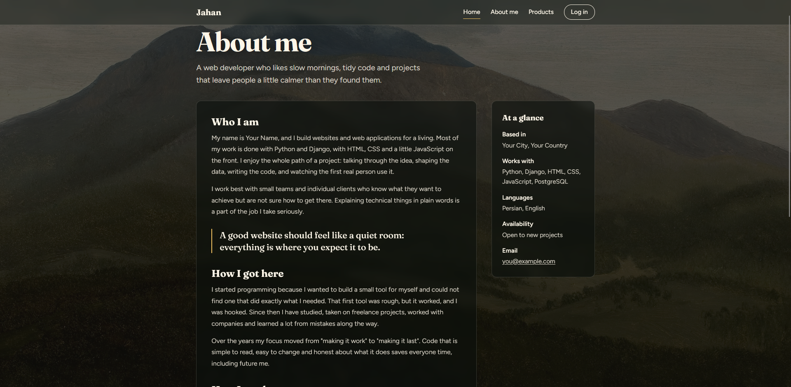
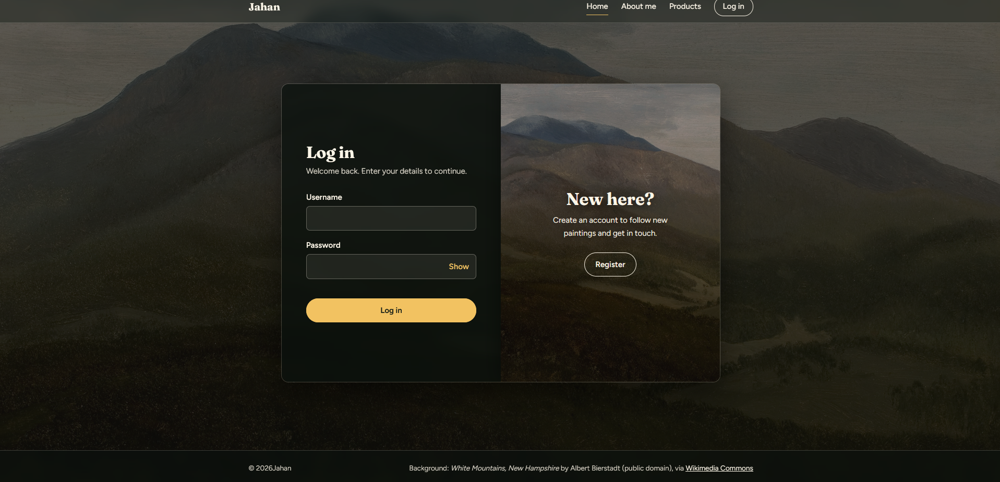
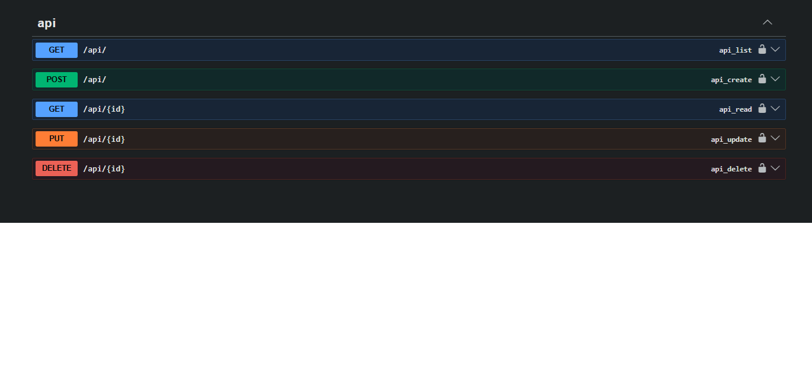
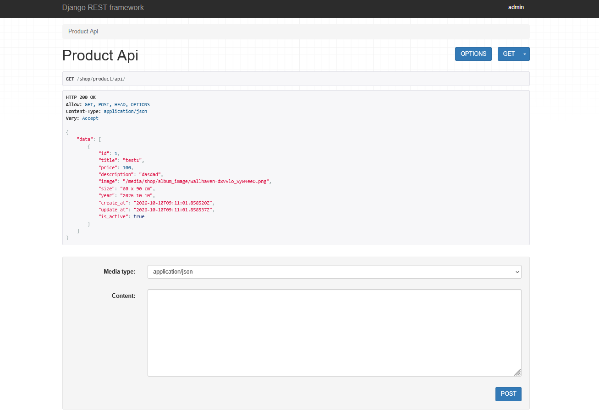
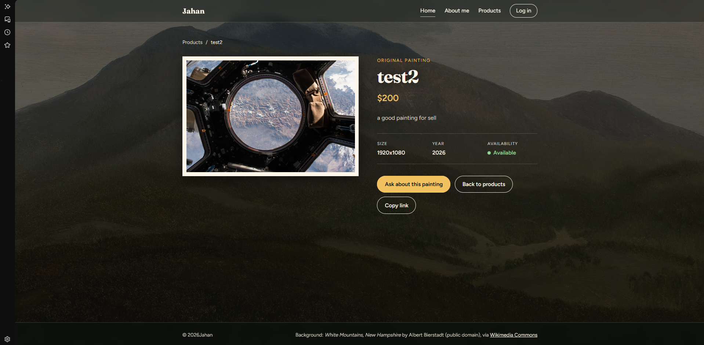

# Album Shop

> A simple, modern, and ready-to-use Django project.

\<!-- A fully functional Django project designed to make selling products online easier. -->

## Overview

\<!--
A simple website for people who want to sell their products without spending
too much time building and maintaining an online store.
It aims to provide a modern design and a reliable backend.
\-->

## Screenshots

### About Page



### Login Page



### Swagger API



### Django REST Framework


### Product Details



## Tech Stack

- **Language:** Python
- **Framework:** Django
- **Database:** SQLite (Development)
- **CI/CD:** GitHub Actions

## Project Structure

```text
Album-shop/
├── .github/
│   └── workflows/
│       └── django.yml
├── docs/
│   └── images/
├── manage.py
├── requirements.txt
├── README.md
└── ...
```

## Requirements

- Python 3.14
- pip
- Git

## Installation

### 1. Clone the repository

```bash
git clone https://github.com/porya1386/Album-shop.git
cd Album-shop
```

### 2. Create a virtual environment

**Windows**

```powershell
python -m venv .venv
.venv\Scripts\activate
```

**Linux / macOS**

```bash
python3 -m venv .venv
source .venv/bin/activate
```

### 3. Install dependencies

```bash
python -m pip install --upgrade pip
pip install -r requirements.txt
```

### 4. Apply database migrations

```bash
python manage.py migrate
```

### 5. Start the development server

```bash
python manage.py runserver
```

Open the application in your browser:

[http://127.0.0.1:8000/](http://127.0.0.1:8000/)

## Configuration

\<!-- Document any required environment variables or project settings here. -->

## Testing

Run the Django test suite:

```bash
python manage.py test
```

Run Django system checks:

```bash
python manage.py check
```

## CI/CD

GitHub Actions is configured to:

- Install project dependencies.
- Run Django system checks.
- Execute automated tests.
- Generate a ZIP artifact after successful tests on the `main` branch.

Workflow file:

`.github/workflows/django.yml`

## Roadmap

- [ ] Add new features.
- [ ] Improve test coverage.
- [ ] Improve documentation.

## License

This project is licensed under the MIT License.

See the [LICENSE](LICENSE) file for details.

## Author

**Porya**

- GitHub: [@porya1386](https://github.com/porya1386)
